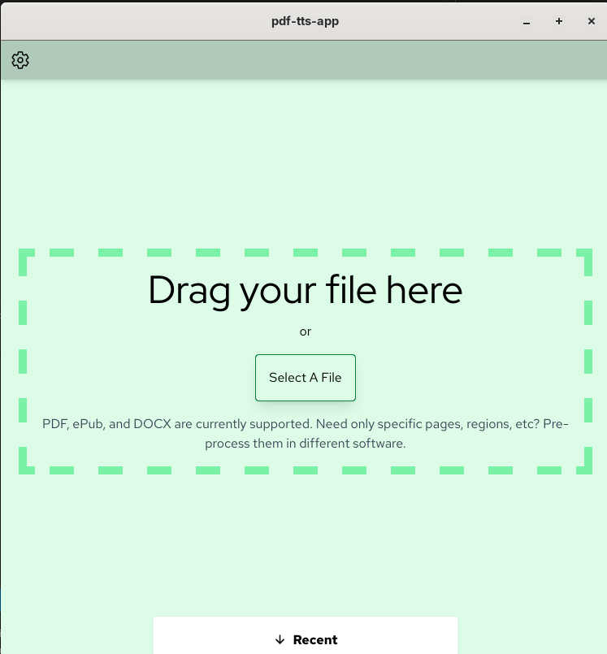
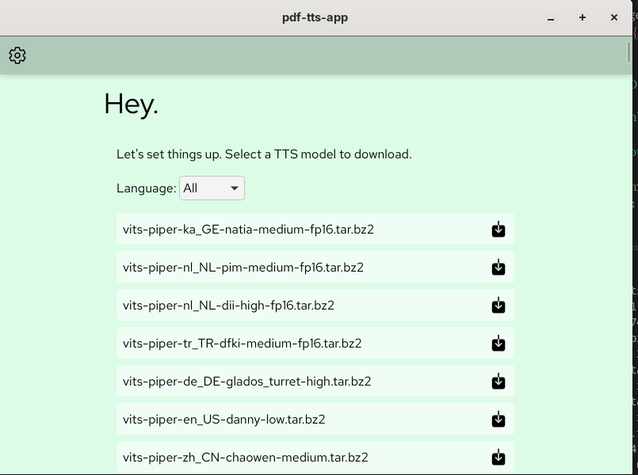

# PDF-TTS-APP
Simple Tauri app that uses sherpa to create a text-to-speech of whatever pdf you send it. Made with Sherpa, Solid.js, and Tauri.
## Screenshots

## TTS Model Support
This project will soon support all k2-fsa TTS models. 
## Project Status
This project is under development. As of last edition of this README, the in-app downloading of TTS models is being worked on, as is the support for TTS models that are not just VITS. The last update will be for simple PDF editing tools to exist (e.g, selecting a range of pages, potentially ignoring headers, stripping of unnecessary characters).
