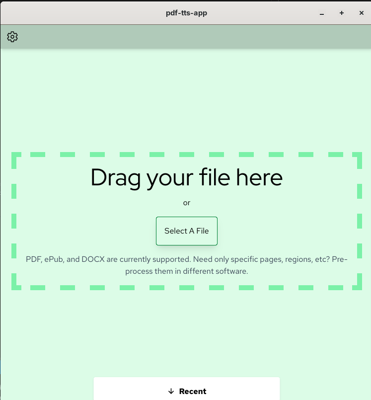
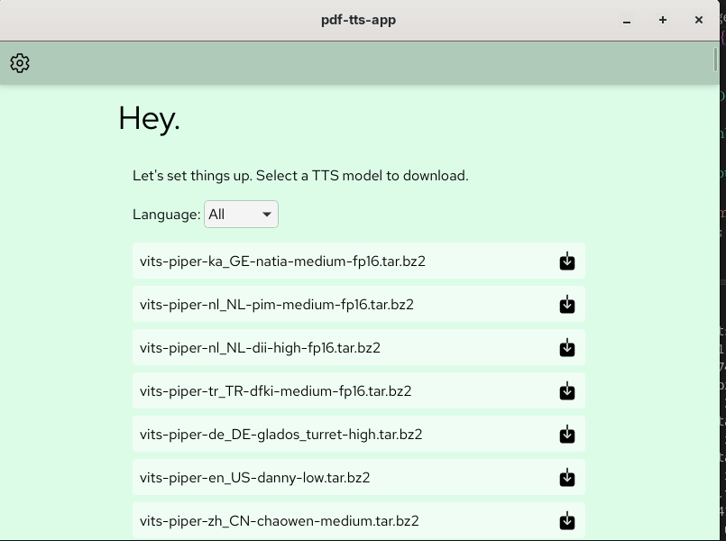

# PDF-TTS-APP
Simple Tauri app that uses sherpa to create a text-to-speech of whatever pdf you send it. Made with Sherpa, Solid.js, and Tauri.
## Screenshots

## Project Architecture

## TTS Model Support
This project currently supports VITS TTS models and will soon support all.
## Project Status
This project is almost complete. As of last edition of this README, the in-app downloading of TTS models is being finished, as is the support for TTS models that are not just VITS. The last update will be for simple PDF editing tools to exist (e.g, selecting a range of pages, potentially ignoring headers, stripping of unnecessary characters).
